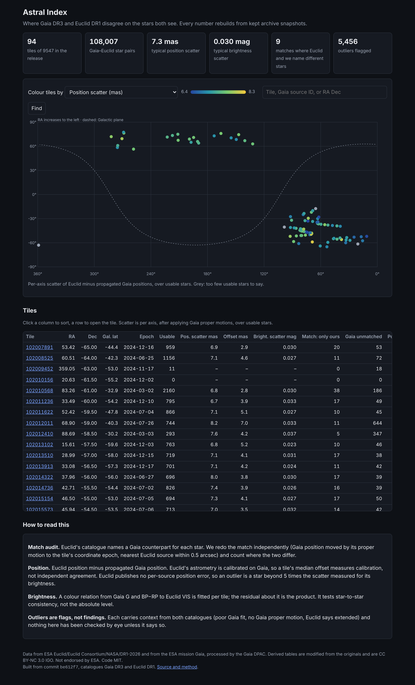

# Astral Index

Where two star catalogues disagree. Gaia DR3 and Euclid DR1 both measure the same stars; this project
records, tile by tile, how far their positions and brightnesses differ, which sources disagree by more than
the measured scatter, and how that changes when either catalogue is re-released. Every number rebuilds from
kept query snapshots.

Status (2026-11-17): 94 of about 9,500 tiles processed and reproducible offline; the explorer site is built
but not deployed. See `GATES.md`.



- `SPEC.md`: what is built and why
- `GATES.md`: the build order and each gate's status
- `SOURCES.md`: the archives, what was read from them, and the licences
- `LOG.md`: the build log
- `astral/`: the code (Python standard library only)
- `fixtures/pilot/`, `snapshots/`: raw archive responses with hash manifests
- `site/`: the explorer's pages; `python -m astral.site` assembles `_site/`
- `data/watch/state.json`: what the archives looked like when last accepted (`python -m astral.watch`)
- `data/tiles/<tile>/`: results per tile

```bash
python -m unittest discover -s tests
```

```bash
python -m astral.batch --sample 100 --offline --redo
```

```bash
python -m astral.site && python -m http.server -d _site 8000
```

Not a catalogue, not a mirror, not a discovery claim.

## Licence and credits

Code: MIT (`LICENSE`). Data files under `fixtures/` and `data/` are derived from Gaia and Euclid data and
are **CC BY-NC 3.0 IGO**: free for non-commercial use with credit. They are modified from the originals, and
neither ESA nor the consortia endorse this project.

- This work has made use of data from the European Space Agency (ESA) mission Gaia
  (https://www.cosmos.esa.int/gaia), processed by the Gaia Data Processing and Analysis Consortium (DPAC,
  https://www.cosmos.esa.int/web/gaia/dpac/consortium). Funding for the DPAC has been provided by national
  institutions, in particular the institutions participating in the Gaia Multilateral Agreement.
- Data from ESA Euclid/Euclid Consortium/NASA/DR1-2026. This work has made use of the Euclid DR1 data from
  the Euclid mission of the European Space Agency (ESA), 2026, https://doi.org/10.57780/esa-d079c51.
